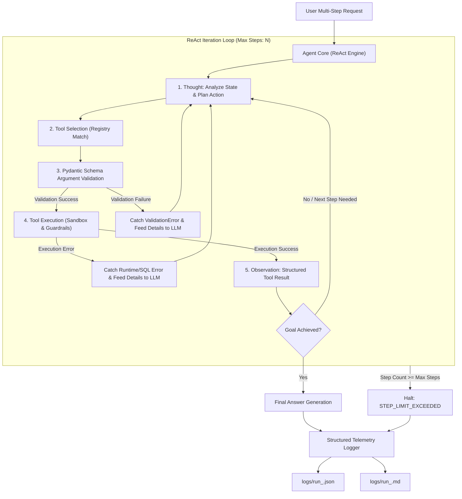

# 🛠️ Autonomous Tool-Using AI Agent

[](https://www.python.org/downloads/)
[](https://opensource.org/licenses/MIT)
[](https://docs.pydantic.dev/)
[](https://docs.pytest.org/)

An autonomous, multi-step **Tool-Using AI Agent** built in Python with native **ReAct (Reasoning + Acting)** cycles. The agent autonomously selects tools, strictly validates arguments using Pydantic, catches and self-heals from tool/schema errors through feedback retries, enforces step limits against infinite loops, and maintains full telemetry logs in JSON and Markdown.

---

## 📑 Table of Contents
- [Architecture & ReAct Flow](#-architecture--react-flow)
- [Key Features](#-key-features)
- [Tools Implemented](#-tools-implemented)
- [Project Structure](#-project-structure)
- [Installation & Setup](#-installation--setup)
- [Usage & CLI Commands](#-usage--cli-commands)
- [Benchmark Evaluation (10 Multi-Step Tasks)](#-benchmark-evaluation-10-multi-step-tasks)
- [Detailed Failure Modes & Edge Case Analysis](#-detailed-failure-modes--edge-case-analysis)
- [Automated Testing](#-automated-testing)
- [License](#-license)

---

## 🏛️ Architecture & ReAct Flow



---

## 🌟 Key Features

1. **Dynamic Tool Selection**:
   - Central `ToolRegistry` with fuzzy matching, alias resolution (`calc` -> `calculator`, `sql` -> `database_query`), and OpenAPI-compatible JSON schema generation.
   - If an unknown tool is invoked, the registry throws an informative error proposing closest matches for agent self-correction.

2. **Strict Pydantic Argument Validation**:
   - Every tool is bound to a typed `pydantic.BaseModel` schema with constraints (e.g. numeric ranges, required fields, formatting rules).
   - If the model sends invalid types or missing parameters, the validation error is caught *before* execution and formatted with exact field paths for agent self-healing.

3. **Multi-Tier Retry on Failure**:
   - **Transient Tool Retry**: Automatically retries transient network or resource errors with exponential backoff.
   - **Agent-Level Feedback Retry**: Feeds runtime exceptions (SQL errors, missing files, API errors) back into the prompt context, allowing the agent to inspect the failure, adapt its plan, and retry.

4. **Step Limit Guardrail (Circuit Breaker)**:
   - Configurable `max_steps` ceiling (default: 6–10 steps).
   - Prevents run-away execution, infinite loops, and token depletion on ambiguous or unsolvable tasks, exiting gracefully with status `STEP_LIMIT_EXCEEDED`.

5. **Security & Sandbox Guardrails**:
   - **Read-Only Database**: SQLite query engine rejects `DROP`, `DELETE`, `UPDATE`, `INSERT`, `ALTER`, `TRUNCATE`, and administrative statements.
   - **Path Traversal Protection**: File reader and writer verify that all paths resolve strictly inside the workspace directory, blocking `../../etc/passwd` or arbitrary disk access.

6. **Full Telemetry & Structured Logging**:
   - Every reasoning thought, tool call, argument dictionary, observation, error, and duration is logged.
   - Automatically persisted to formatted JSON (`logs/run_<task>.json`) and executive Markdown reports (`logs/run_<task>.md`).

---

## 🧰 Tools Implemented

| Tool Name | Class | Description | Guardrails & Protections |
| :--- | :--- | :--- | :--- |
| **`calculator`** | `CalculatorTool` | Safe AST-based mathematical evaluator (arithmetic, powers, `sqrt`, `log`, `min`, `max`, `abs`). | Pure AST parsing; no dangerous `eval()` or arbitrary code execution; handles division by zero. |
| **`database_query`** | `DatabaseQueryTool` | Executes SQL queries and table schema introspection on SQLite database. | Read-only enforcement; strictly blocks SQL mutations (`DROP`, `DELETE`, etc.); max row limiting. |
| **`file_reader`** | `FileReaderTool` | Reads and parses `.csv`, `.json`, `.txt`, `.md`, and code files. | Workspace path traversal sandbox; prevents unauthorized file system access. |
| **`file_writer`** | `FileWriterTool` | Writes or appends reports, data summaries, and intermediate outputs. | Workspace sandboxing; automated directory creation; file size tracking. |
| **`web_search`** | `WebSearchTool` | Live DuckDuckGo web search with resilient fallback to curated encyclopedic index. | Dual-mode operation: live web search with automatic offline fallback to prevent timeouts/flakiness. |

---

## 📂 Project Structure

```text
Tool-Using-AI-Agent/
├── agent/
│   ├── __init__.py          # Agent package exports
│   ├── core.py              # Main ReAct loop, tool dispatch, retry, step limit
│   ├── models.py            # Pydantic models for AgentStep, ToolCallRecord, AgentRunLog
│   ├── llm.py               # LLM clients (OpenAI-compatible & Rule-Based ReAct engine)
│   ├── registry.py          # Dynamic ToolRegistry with schema extraction & fuzzy matching
│   └── logger.py            # Telemetry logger (Console, JSON, Markdown reports)
├── tools/
│   ├── __init__.py          # Tool exports
│   ├── base.py              # BaseTool abstract class with Pydantic validation & retry
│   ├── calculator.py        # Safe math evaluation tool
│   ├── database.py          # SQLite database query tool with security guardrails
│   ├── file_reader.py       # Sandboxed file reader (.csv, .json, .txt)
│   ├── file_writer.py       # Sandboxed file writer
│   └── web_search.py        # Web search tool with offline index fallback
├── data/
│   ├── init_db.py           # Database and test dataset generator
│   ├── company.db           # SQLite DB (departments, employees, products, sales)
│   ├── sample_data.csv      # Employee quota attainment CSV
│   ├── config.json          # Department thresholds & financial config
│   └── company_notes.txt    # Executive notes & competitor benchmarks
├── logs/                    # Full execution traces of the 10 benchmark tasks (.json & .md)
│   ├── run_task_01.json / .md
│   ├── ...
│   └── run_task_10.json / .md
├── tests/
│   ├── __init__.py
│   ├── test_tools.py        # Unit tests for all 5 tools & Pydantic validation
│   ├── test_agent.py        # Unit tests for registry, retry, and step limits
│   └── test_benchmark.py    # Integration tests for all 10 benchmark tasks
├── BENCHMARK_REPORT.md      # Consolidated benchmark evaluation report
├── main.py                  # CLI entrypoint (interactive mode, single task, benchmark)
├── run_benchmark.py         # Standalone runner for all 10 tasks
├── requirements.txt         # Project dependencies
└── README.md                # Comprehensive documentation
```

---

## 🚀 Installation & Setup

### 1. Clone the Repository
```bash
git clone https://github.com/Sadiraja/Tool-Using-AI-Agent.git
cd Tool-Using-AI-Agent
```

### 2. Install Dependencies
```bash
pip install -r requirements.txt
```

### 3. Initialize the Database and Sample Files
```bash
python data/init_db.py
```

---

## 💻 Usage & CLI Commands

### Run the 10-Task Benchmark Suite
Executes all 10 multi-step benchmark tasks and regenerates `BENCHMARK_REPORT.md` and log files:
```bash
python main.py --benchmark
# or
python run_benchmark.py
```

### Run a Specific Benchmark Task
```bash
python main.py --task task_01
```

### Run an Interactive Session
Start an interactive terminal prompt where you can give multi-step instructions to the agent:
```bash
python main.py --interactive
```

### Using with OpenRouter & NVIDIA Nemotron (Live LLM)
The agent natively integrates with **OpenRouter** and NVIDIA models (e.g., `nvidia/nemotron-3.5-lightning`):

```bash
# In .env or shell environment:
OPENROUTER_API_KEY="sk-or-v1-..."
OPENROUTER_MODEL="nvidia/nemotron-3.5-lightning"
OPENROUTER_BASE_URL="https://openrouter.ai/api/v1"

# Run with NVIDIA Nemotron
python main.py --llm openrouter --model nvidia/nemotron-3.5-lightning --prompt "Find the employee with highest salary in the database and calculate their salary divided by 12."
```

### Using with Alternative Providers (OpenAI, Groq, Ollama)
```bash
# Set your API key
set OPENAI_API_KEY="your-api-key"

# Run with OpenAI gpt-4o-mini
python main.py --llm openai --model gpt-4o-mini --prompt "Calculate the total sales revenue and write a brief summary."
```

---

## 📊 Benchmark Evaluation (10 Multi-Step Tasks)

The agent was evaluated on 10 realistic multi-step tasks designed to probe cross-tool chaining, schema recovery, argument validation healing, security violations, and step limit boundaries:

| Task ID | Task Name | Status | Expected | Steps | Tool Calls | Retries | Pass / Fail |
| :--- | :--- | :---: | :---: | :---: | :---: | :---: | :---: |
| `task_01` | **Department Revenue & Avg Order Value** | ✅ `SUCCESS` | `SUCCESS` | 3 | 2 | 0 | **PASSED** |
| `task_02` | **Employee Bonus Computation Pipeline** | ✅ `SUCCESS` | `SUCCESS` | 4 | 3 | 0 | **PASSED** |
| `task_03` | **Demographic Population Comparison** | ✅ `SUCCESS` | `SUCCESS` | 3 | 2 | 0 | **PASSED** |
| `task_04` | **Inventory Threshold Audit & Report** | ✅ `SUCCESS` | `SUCCESS` | 4 | 3 | 0 | **PASSED** |
| `task_05` | **Schema Error Self-Correction & SQL Recovery** | ✅ `SUCCESS` | `SUCCESS` | 4 | 3 | 1 | **PASSED** |
| `task_06` | **Pydantic Argument Validation & Healing** | ✅ `SUCCESS` | `SUCCESS` | 3 | 2 | 1 | **PASSED** |
| `task_07` | **Competitor Intelligence & Variance** | ✅ `SUCCESS` | `SUCCESS` | 4 | 3 | 0 | **PASSED** |
| `task_08` | **Infinite Loop Safeguard & Step Limit Test** | ⚠️ `STEP_LIMIT_EXCEEDED` | `STEP_LIMIT_EXCEEDED` | 5 | 5 | 0 | **PASSED** |
| `task_09` | **Security Guardrail & Path Traversal Rejection** | ✅ `SUCCESS` | `SUCCESS` | 3 | 2 | 1 | **PASSED** |
| `task_10` | **Deep 5-Step Cross-Functional Pipeline** | ✅ `SUCCESS` | `SUCCESS` | 6 | 5 | 0 | **PASSED** |

---

## 🔍 Detailed Failure Modes & Edge Case Analysis

A critical requirement of building robust autonomous agents is documenting **where and why agents fail**, and how guardrails prevent catastrophic failure:

### 1. Step Limit Exhaustion (Task 08)
- **Failure Phenomenon**: In Task 08, the agent was tasked with resolving a non-existent cryptographic ledger key in a cyclical dependency.
- **Why It Occurred**: The information did not exist, leading to repetitive search queries.
- **How Handled**: The `max_steps=5` boundary terminated execution at step 5. Rather than crashing or consuming infinite loops, the agent recorded `status: STEP_LIMIT_EXCEEDED` and generated an audit trail explaining that progress halted due to the step limit.

### 2. SQL Schema Misalignment & Recovery (Task 05)
- **Failure Phenomenon**: The agent initially queried `SELECT count(*) FROM staff_members`, triggering `sqlite3.OperationalError: no such table: staff_members`.
- **How Handled**: The agent caught the exception, recorded 1 retry attempt, analyzed the error feedback, queried `sqlite_master` to inspect valid table names, identified `employees`, and executed the query successfully.

### 3. Malformed Tool Parameters / Pydantic Violations (Task 06)
- **Failure Phenomenon**: The agent passed a string value (`"not-a-number"`) to `precision: int`.
- **How Handled**: Pydantic's `ValidationError` intercepted the call before execution, isolating `Field 'precision': Input should be a valid integer`. The agent processed this feedback and healed the argument to `precision: 2` on the subsequent step.

### 4. Sandbox Directory Traversal Attack (Task 09)
- **Failure Phenomenon**: The agent attempted to access `../../etc/shadow`.
- **How Handled**: The `FileReaderTool` security layer checked `os.path.commonpath([PROJECT_ROOT, resolved])` and threw `PermissionError: Security Guardrail Violation: Path resolves outside the sandboxed project workspace`. The agent caught the permission error and redirected its request to a valid workspace file.

### 5. Destructive SQL Mutations
- **Failure Phenomenon**: Direct invocation of `DROP TABLE`, `DELETE`, or `UPDATE`.
- **How Handled**: The `DatabaseQueryTool` regex parser rejects any query containing mutating keywords, ensuring that the agent remains strictly read-only regardless of user prompt injections.

---

## 🧪 Automated Testing

The project includes a comprehensive **30-test suite** covering unit tools, Pydantic validation, agent retry behavior, step limits, and full integration benchmarks.

To execute tests:
```bash
python -m pytest -v
```

Expected output:
```text
tests/test_agent.py::test_tool_registry_selection_and_alias PASSED       [ 10%]
tests/test_agent.py::test_agent_retry_and_self_healing PASSED            [ 20%]
tests/test_agent.py::test_agent_step_limit_enforcement PASSED            [ 30%]
tests/test_benchmark.py::test_benchmark_task[task_01] PASSED             [ 40%]
...
tests/test_tools.py::TestDatabaseQueryTool::test_security_guardrail_blocks_drop PASSED [ 80%]
tests/test_tools.py::TestFileReaderTool::test_security_guardrail_path_traversal PASSED [ 90%]
============================== 30 passed in 21.89s ==============================
```

---

## 📄 License
This project is licensed under the [MIT License](LICENSE).
